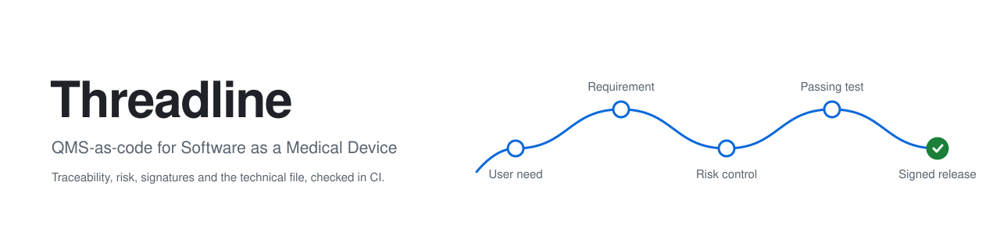
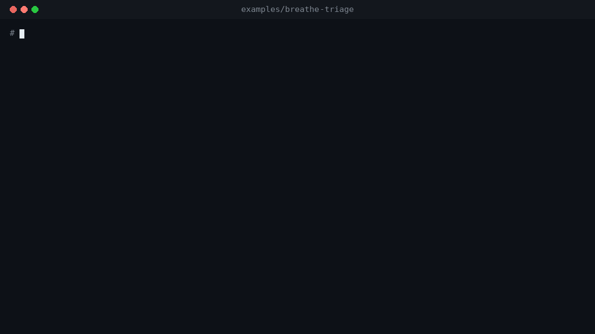
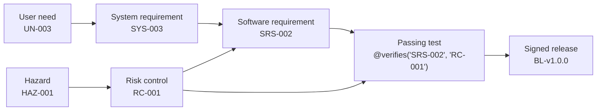
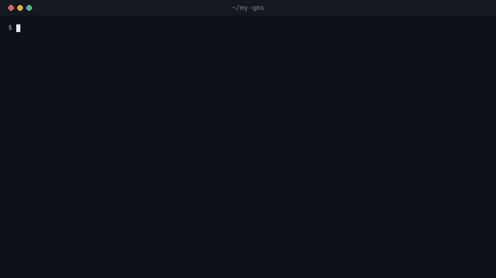

<p align="center">
  <picture>
    <source media="(prefers-color-scheme: dark)" srcset="docs/assets/banner-dark.svg">
    
  </picture>
</p>

<p align="center">
  <a href="https://github.com/JFrusher/Threadline/actions/workflows/ci.yml"></a>
  
  
  <a href="LICENSES/Apache-2.0.txt"></a>
  <a href="LICENSES/CC-BY-4.0.txt"></a>
</p>

<p align="center">
  <a href="#quickstart">Quickstart</a> ·
  <a href="docs/getting-started.md">Tutorial</a> ·
  <a href="docs/concepts.md">Concepts</a> ·
  <a href="docs/rules.md">Rules</a> ·
  <a href="docs/for-qa-ra.md">For QA/RA</a> ·
  <a href="docs/for-auditors.md">For auditors</a>
</p>

---

If you build software that is a medical device, you know the routine. Requirements live in a spreadsheet, the risk
file in a Word document, test evidence in someone's CI history, and approvals in an email thread. Every audit someone
spends a week rebuilding the links between them by hand, and finds the ones that broke months ago.

**Threadline keeps that evidence in git, next to the code, and checks it on every pull request.** Each user need,
requirement, hazard, risk control, SOUP entry and approval is one small YAML file. Tests declare which requirements
they verify. Approvals are SSH-signed commits. `threadline check` walks the whole graph and fails the build the moment
the thread breaks. When you tag a release, `threadline build` turns the same files into an audit-ready technical
file.

<p align="center">
  
</p>

<details>
<summary>Text of this recording</summary>

An off-by-one (`>=` became `>`) slips into the fast-breathing threshold of the example device. The tests fail, and
Threadline turns that into regulatory language: which requirements and which risk control lost their evidence.

```console
$ threadline check --junit junit.xml --trust-root $ROOT
TL-E01 [IEC 62304 5.7] SRS-002: failing verification: tests.test_triage::test_infant_threshold[2-50-FAST_BREATHING], tests.test_triage::test_infant_threshold[11-50-FAST_BREATHING]
TL-E01 [IEC 62304 5.7] SRS-003: failing verification: tests.test_triage::test_child_threshold[12-40-FAST_BREATHING], tests.test_triage::test_child_threshold[59-40-FAST_BREATHING]
TL-R04 [ISO 14971 7.2] RC-001: failing verification: tests.test_triage::test_infant_threshold[2-50-FAST_BREATHING], ...
3 finding(s), 5 rule(s) skipped, 200 items
```

After the fix: `0 finding(s), 5 rule(s) skipped, 200 items`.
</details>

> [!IMPORTANT]
> Threadline is not a certified quality management system and does not make any device compliant. It is tooling
> that your QMS may adopt, and you must validate it for your own intended use (ISO 13485:2016 §4.1.6). The example
> device in [`examples/`](examples/breathe-triage) is fictional; its clinical and usability data are illustrative.

## Who it's for

| You are… | Threadline gives you | Start here |
|---|---|---|
| **An engineer on a SaMD team** | A CI check that tells you, in clause language, what your change broke. No Word documents. | [Tutorial](docs/getting-started.md) |
| **A QA or regulatory lead** | Every clause mapped to a record, approvals bound to content, and a technical file you can rebuild for any tag. | [Guide for QA/RA](docs/for-qa-ra.md) |
| **An auditor or Approved Body reviewer** | A PDF tied to one commit, with signatures you can verify offline from the repository. | [Guide for auditors](docs/for-auditors.md) |
| **A founder or consultant** | A complete, passing example device to fork, with SOPs and profiles for the UK and African markets. | [Worked example](#the-worked-example) |

## How it works



1. **One file per item.** `dhf/srs/SRS-002.yaml` holds requirement `SRS-002`. Links live on the child and point up
   (`derives_from: [SYS-003]`, `implements: [RC-001]`). `git log` on a file is that item's full history.
2. **Tests carry the link.** `@pytest.mark.verifies("SRS-002", "RC-001")` writes a property into the JUnit XML. Any
   language that can write that property works.
3. **Rules walk the graph.** 32 rules, each citing its clause in ISO 13485, IEC 62304, ISO 14971, IEC 62366-1,
   IEC 81001-5-1, BS/AAMI 34971, UK MDR 2002 or the AU Model Law. Any finding exits non-zero.
4. **Approvals are signatures.** An approval record is committed in an SSH-signed commit by its signer, and binds to
   the SHA-256 of what was approved. Edit the document and the approval no longer counts.
5. **Releases are rebuilt, not assembled.** Tag a version and CI re-runs the tests, generates an SBOM, checks every
   rule and writes the technical file, hazard log and evidence to a GitHub Release with a provenance attestation.

Read [Concepts](docs/concepts.md) for the longer version.

## Quickstart

You need Python 3.12+ and git.

```bash
pip install pytest "threadline @ git+https://github.com/JFrusher/Threadline"
```

```bash
threadline init my-qms && cd my-qms
```

```bash
git init && git add -A && git commit -m "Start the QMS"
```

```bash
pytest --junitxml=junit.xml && threadline check --junit junit.xml
```

> [!NOTE]
> Threadline is not on PyPI yet; install it from GitHub as above. Commit once before your first `check`: Threadline
> reads signatures and the signer registry from git history, and the first commit becomes your root of trust.

The new repository fails with 56 findings, and that is the point. Every finding names a clause you haven't covered
yet. Work through them until `check` is green.

<p align="center">
  
</p>

The [tutorial](docs/getting-started.md) takes you from here to your first green check, one rule family at a time.

## What you get

| Command | What it does |
|---|---|
| `threadline init <dir>` | New QMS repository: ten SOPs, CI workflows, PR template, CODEOWNERS, a stub for every checklist clause, editor autocompletion |
| `threadline check` | Run every rule. Exit 1 on any finding. `--format github` annotates the PR diff inline |
| `threadline rtm` | Print the requirements traceability matrix as Markdown |
| `threadline build` | Technical file PDF and DCB0129 hazard log. Refuses to build while anything is red |
| `threadline approve ID…` | Write approval records and commit them in one SSH-signed commit |
| `threadline baseline V` | Freeze the design file for release `V` |
| `threadline preset add <name>` | Add a ready-made risk pack with cited sources and failing test stubs |
| `threadline hash <file>` | The content hash an approval signs, or the SHA-256 of a dataset or weights file |

Full flags and examples: [CLI reference](docs/cli.md).

### The technical file

`threadline build` compiles everything into one PDF with a table of contents, hyperlinked item IDs, printed
signature manifestations, and the release tag and commit on every page. Next to it: a DCB0129 hazard log, the JUnit
evidence and the SBOM.

<p align="center">
  
</p>

### Standards covered

| Area | Standard | What Threadline checks |
|---|---|---|
| Quality system | ISO 13485:2016 | Clause map to evidence, document control, approvals, records, tool validation |
| Software lifecycle | IEC 62304 (Ed1 A/B/C, or the Ed2 draft PRL I/II) | Deliverables per class, traceability, verification, SOUP |
| Risk | ISO 14971:2019 | Hazards, P1 × P2 against your policy, controls, residual risk, benefit-risk |
| Usability | IEC 62366-1 | Use scenarios, summative protocol and report coverage |
| Security | IEC 81001-5-1 | Threats, security controls, vulnerability triage against OSV.dev |
| AI/ML | BS/AAMI 34971 | Datasets, weights hashes, subgroup metrics, PCCP |
| UK | UK MDR 2002 | Essential requirements checklist, classification, PMS |
| Africa | AU Model Law / WHO GMRF | Essential principles checklist, classification |
| E-signatures | 21 CFR Part 11 (as a benchmark) | [Gap analysis](docs/guides/part11-gap-analysis.md) |

Some clause data was transcribed without the licensed text. It says so in every `check` run, and the
[PRD evidence ledger](docs/PRD.md#11-evidence-ledger--what-is-verified-and-what-is-not) lists what is verified and
what is not.

### Presets for low-resource settings

Each preset adds hazards, risk controls, requirements and failing test stubs, every hazard cited to a published
source.

| Preset | For |
|---|---|
| `power-loss` | Facilities with unreliable electricity |
| `offline-queue` | Devices that work offline and sync later |
| `low-bandwidth-telemetry` | Expensive or patchy mobile data |
| `ml-34971` | Machine-learning hazards from BS/AAMI 34971 |

## Put it in CI

```yaml
# .github/workflows/threadline.yml (threadline init writes the full version for you)
- uses: actions/checkout@v4
  with:
    fetch-depth: 0  # signatures and history are evidence
- run: pip install pytest "threadline @ git+https://github.com/JFrusher/Threadline" && pytest --junitxml=junit.xml
- uses: JFrusher/Threadline@<commit-sha>
  with:
    junit: junit.xml
    base: origin/${{ github.base_ref }}
    trust-root: ${{ vars.THREADLINE_TRUST_ROOT }}
```

Findings appear as annotations on the changed files in the pull request. See [CI and releases](docs/ci-and-releases.md) for
the SBOM and release workflows, baselines and the trust root, and [branch protection](docs/guides/branch-protection.md)
for signing approvals.

## The worked example

[`examples/breathe-triage`](examples/breathe-triage) is a fictional IEC 62304 class C device: an offline tool that
helps community health workers count a child's breathing rate and apply WHO IMCI danger-sign rules. It exists to
exercise every part of Threadline, and passes every rule.

It has 200 items: user needs through software requirements, a full ISO 14971 risk file, an IEC 62366-1 usability
file, a threat model, an ML model with hashed datasets, clause maps for ISO 13485, UK MDR 2002 and the AU Model Law,
ten SOPs with SSH-signed approvals, and a signed release baseline. Run it yourself:

```bash
git clone https://github.com/JFrusher/Threadline && cd Threadline/examples/breathe-triage
```

```bash
pip install pytest -e ../.. && pytest --junitxml=junit.xml
```

```bash
threadline check --junit junit.xml --trust-root 87785d9a6e5fd9fa56d7f36ca3256c91d349238a
```

## Rules

Every rule has a passing and a failing fixture in [`tests/fixtures/`](tests/fixtures). That suite is Threadline's own
tool-validation evidence and ships with every release. The [rule reference](docs/rules.md) lists all 32 with
their clauses, the input each needs, and how to fix each one.

## Status

Threadline is **pre-1.0**. The rule engine, signatures, release workflow and example are complete and tested. Before
1.0: a review of the example technical file by an outside QA/RA reviewer, publishing to PyPI, and a tagged release of
the GitHub Action. Regulatory claims that are not yet verified are listed in the
[PRD evidence ledger](docs/PRD.md#11-evidence-ledger--what-is-verified-and-what-is-not); templates never cite them as
fact.

## Documentation

| | |
|---|---|
| **Learn** | [Getting started](docs/getting-started.md) · [Concepts](docs/concepts.md) |
| **Reference** | [CLI](docs/cli.md) · [Configuration](docs/configuration.md) · [Item types](docs/items.md) · [Rules](docs/rules.md) |
| **Guides** | [CI and releases](docs/ci-and-releases.md) · [Branch protection and signing](docs/guides/branch-protection.md) · [Part 11 gap analysis](docs/guides/part11-gap-analysis.md) |
| **For reviewers** | [QA/RA](docs/for-qa-ra.md) · [Auditors](docs/for-auditors.md) · [Tool validation](docs/tool-validation/threadline-intended-use-and-risk.md) |
| **Design** | [PRD](docs/PRD.md) · [Plan](docs/PLAN.md) · [ADR-001](docs/adr/ADR-001-one-yaml-per-item.md) · [ADR-002](docs/adr/ADR-002-junit-property-test-link.md) · [ADR-003](docs/adr/ADR-003-signed-approval-records.md) |

## Contributing

Contributions are welcome, especially corrections to regulatory claims. Every rule needs a passing and a failing
fixture, and every regulatory claim needs a verified source. See [CONTRIBUTING.md](CONTRIBUTING.md), and
[SECURITY.md](SECURITY.md) for reporting vulnerabilities privately.

## Licences

- Code (`src/threadline/*.py`, `tests/`, workflows): [Apache-2.0](LICENSES/Apache-2.0.txt)
- Templates, SOPs, presets, the example design file and docs (`src/threadline/template/`, `src/threadline/data/`,
  `examples/`, `docs/`): [CC-BY-4.0](LICENSES/CC-BY-4.0.txt)
