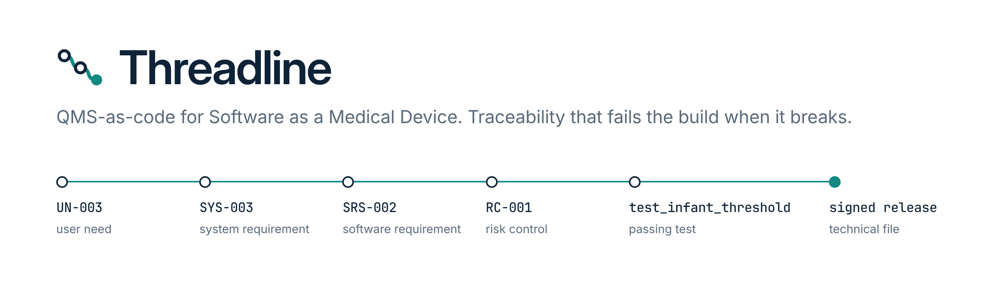
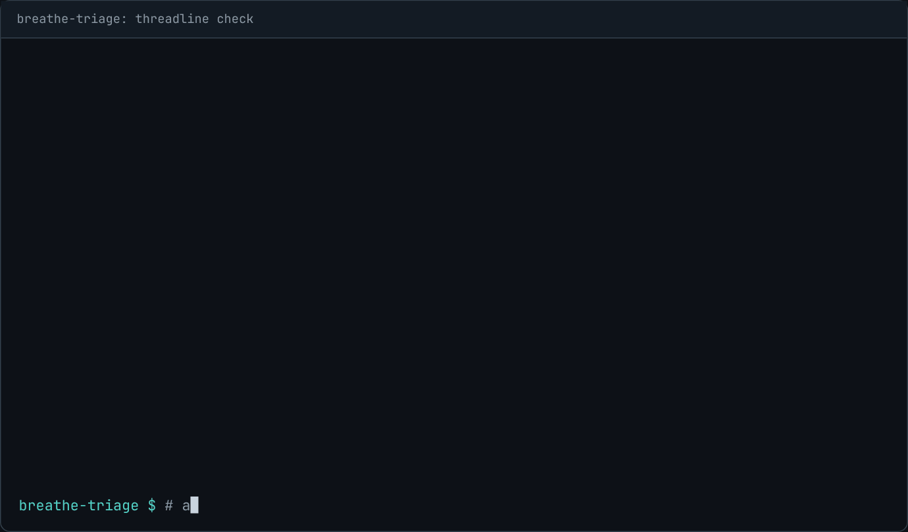
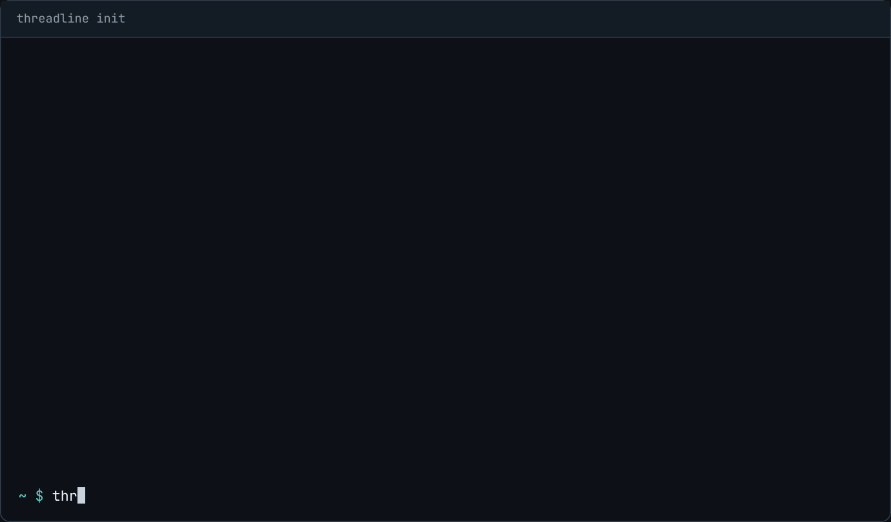
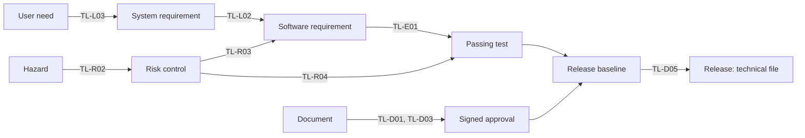
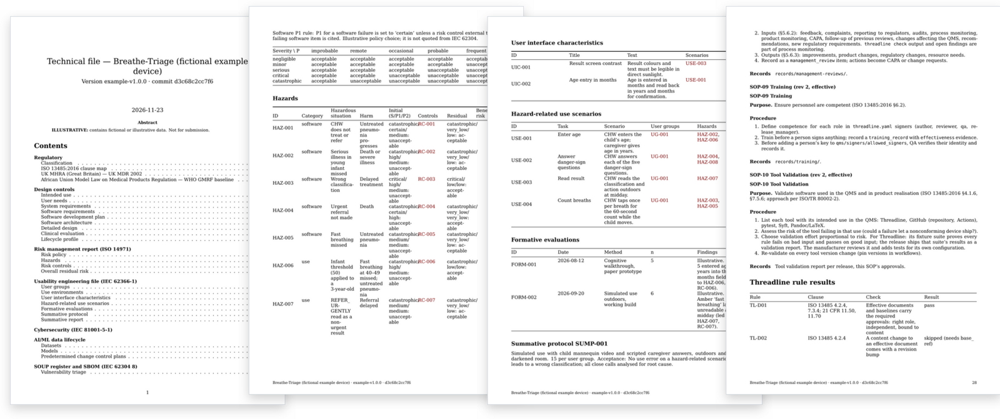

<picture>
  <source media="(prefers-color-scheme: dark)" srcset="docs/assets/banner-dark.png">
  
</picture>

[](https://github.com/JFrusher/threadline/actions/workflows/ci.yml)


Threadline keeps a medical device's regulatory records in git, one YAML file per item, and checks them in CI.
If a requirement loses its test, a hazard loses its control, or a signed SOP changes without a new revision,
the build fails and the message names the clause. When everything holds, the same records compile into a
technical file PDF tied to the release commit.

It targets the **UK (MHRA)** and **Africa (AU Model Law / WHO GMRF baseline)**.

> [!IMPORTANT]
> Threadline is not a certified quality management system and does not make any device compliant. It is
> tooling that a manufacturer's QMS may adopt, and the manufacturer must validate it for its own intended use
> (ISO 13485:2016 §4.1.6). The example device in `examples/` is fictional; its clinical and usability data are
> illustrative only.

## What a failure looks like

A refactor removes the marker linking one test to a requirement and a risk control. The tests still pass,
but requirement SRS-004 and risk control RC-004 are left with no evidence.



```text
TL-E01 [IEC 62304 5.7] SRS-004: no test verifies this item
TL-R04 [ISO 14971 7.2] RC-004: no test verifies this item
2 finding(s), 5 rule(s) skipped, 200 items
```

This is real output from the worked example in [`examples/breathe-triage`](examples/breathe-triage). The
recording is regenerated by [`docs/assets/make.mjs`](docs/assets/make.mjs), which runs these commands and
captures what they print.

## Quickstart

Python 3.12 or newer. Install from git:

```bash
pip install git+https://github.com/JFrusher/threadline
```

```bash
threadline init my-qms && cd my-qms
```

```bash
git init && git add -A && git commit -m "QMS scaffold"
```

```bash
pytest --junitxml=junit.xml
```

```bash
threadline check --junit junit.xml
```

A new repository fails its first check. `init` gives you SOPs, CI workflows, a PR template, CODEOWNERS and an
editor schema, but no design file, so `check` lists every deliverable your software class and markets
require:



[Getting started](docs/getting-started.md) takes one requirement from red to green.

## How the thread is checked

Each arrow below is a link stored in a YAML file. Each label is the rule that fails when the link is missing.



A link to a test is one line in the test itself:

```python
@pytest.mark.verifies("SRS-004", "RC-004")
@pytest.mark.parametrize("sign", DANGER_SIGNS)
def test_danger_sign_overrides(sign):
    assert classify(30, 20, NONE | {sign: True}) == "REFER_URGENTLY"
```

The marker writes a `verifies` property into JUnit XML, so any test framework that emits JUnit can do the
same ([ADR-002](docs/adr/ADR-002-junit-property-test-link.md)). Approvals are YAML records committed in
SSH-signed commits and verified against a signer registry in the repository
([ADR-003](docs/adr/ADR-003-signed-approval-records.md)). Changes to that registry must themselves be signed by
an existing QA signer (TL-D04), counted from a trust root commit that CI supplies from outside the repository.

## What it checks

Every rule cites the clause it enforces and has a passing and a failing fixture in
[`tests/fixtures`](tests/fixtures).

| Family | Rules | Source | Fails when |
|---|---|---|---|
| Structure and links | TL-S01, TL-L01 to L05 | ISO 13485 4.2.4, 7.3; IEC 62304 5.1, 5.2 | A file is invalid, a link dangles or points at the wrong type, a requirement traces to nothing, the graph has a cycle, a live item links to an obsolete one |
| Verification evidence | TL-E01, TL-E02 | IEC 62304 5.7 | A software requirement has no tests or one of its tests fails, or a test claims an unknown item |
| Risk management | TL-R01 to R06 | ISO 14971 5.4 to 7.5 | A hazard is not estimated, an unacceptable risk has no control, a control is unimplemented, unverified or not reviewed for new hazards |
| Document control and release | TL-D01 to D05 | ISO 13485 4.2.4, 7.3.4; 21 CFR 11.50, 11.70, 11.100; IEC 62304 5.8 | An approval is missing, self-signed, bound to other content or not SSH-signed by its signer; content changed without a revision bump; the signer registry changed without a QA signature; a release has no approved baseline matching the design file |
| Lifecycle | TL-C01 | IEC 62304 (Ed1 classes A/B/C, or the Ed2 draft PRL I/II) | A deliverable the software class requires does not exist |
| SOUP | TL-P01 to P03 | IEC 62304 7.1.2, 8.1.2; IEC 81001-5-1 | The SBOM and the SOUP register disagree, or an OSV advisory has no triage record |
| Usability | TL-U01 to U03 | IEC 62366-1 5.4 to 5.7 | A hazard-related use scenario is untested in the summative evaluation |
| Security | TL-T01, TL-T02 | IEC 81001-5-1 5.2, 7 | A threat is unassessed or uncontrolled |
| AI/ML | TL-M01, TL-M02 | BS/AAMI 34971; IEC 62304 8.1 | A model lacks datasets, subgroup metrics or acceptance criteria, or a weights or dataset file does not match its registered SHA-256 |
| Regulatory | TL-G01, TL-G02 | ISO 13485 4.2.3; UK MDR 2002; AU Model Law | A checklist clause of an active profile is neither mapped to evidence nor justified, or a classification is missing |

Full table with clause numbers: [docs/rules.md](docs/rules.md).

## The technical file

`threadline build` refuses to run while any rule fails. When it runs, it produces a PDF and a DCB0129 hazard
log with the version and commit in every page footer.

A release starts with `threadline baseline v1.2.0`, which records a hash of the whole design file, and a
`released` approval of that baseline by a release manager. On the tag, the release workflow re-runs the test
suite, and `threadline build --release` refuses if the design file no longer matches the baseline or if any
rule was skipped. The PDF, JUnit XML and SBOM are attached to the GitHub Release with a build-provenance
attestation. The steps are in [CI and releases](docs/ci-and-releases.md).



Shown: contents, the hazard table and the signature table from the file built for the example device. The
cover marks it illustrative because the device is fictional.

## Where to start

| If you are | Read |
|---|---|
| An engineer adding this to a codebase | [Getting started](docs/getting-started.md), [CLI reference](docs/cli.md), [CI and releases](docs/ci-and-releases.md) |
| QA/RA, deciding whether it fits your QMS | [Threadline for QA/RA](docs/for-qa-ra.md), [Concepts](docs/concepts.md), [Rule reference](docs/rules.md), [Part 11 gap analysis](docs/guides/part11-gap-analysis.md), [tool risk assessment](docs/tool-validation/threadline-intended-use-and-risk.md) |
| A founder or consultant scoping a submission | The [worked example](examples/breathe-triage) and [Status and limits](#status-and-limits) below |
| An auditor handed a Threadline technical file | [Reading a Threadline technical file](docs/for-auditors.md) |

All documentation: [docs/](docs/README.md).

## Compared with documents and spreadsheets

| | Word, Excel, wiki | Threadline |
|---|---|---|
| Traceability matrix | Maintained by hand, checked before audits | Derived from links on every commit; a broken link fails the build |
| Test evidence | Copied into a report | JUnit XML from the run on the release commit, hashed and embedded |
| Approvals | Signature block or e-sign tool | SSH-signed commit bound to a content hash, checked for role and independence |
| SOUP list | Updated when someone remembers | Compared with the SBOM on every pull request, advisories pulled weekly |
| Technical file | Assembled by hand | Compiled from the same records, only when every rule passes |
| Review interface | Tracked changes | Pull requests |
| Needs | Nothing new | Git, CI, and people willing to edit YAML |

Threadline has no web interface, hosting or user management. If your reviewers will not work in pull
requests, it is the wrong tool.

## Worked example

[`examples/breathe-triage`](examples/breathe-triage) is a fictional IEC 62304 class C device: an offline
respiratory-rate triage aid for community health workers. It holds requirements,
hazards and risk controls, a usability file, a threat model, an ML model with dataset hashes, clause maps
for ISO 13485, UK MDR 2002 and the AU Model Law, SOPs with signed approvals, and an approved release
baseline. Its test suite carries the
evidence. This repository's CI runs `threadline check` on it for every change.

## Status and limits

Threadline is pre-1.0 and is not published to PyPI. Before relying on it, know that:

- The IEC 62304 clause-to-class mapping was transcribed without access to the licensed text. Check it
  against your copy. `threadline check` prints this note on every run.
- The IEC 62304 Ed2 profile follows a committee draft and prints `DRAFT STANDARD` in all output.
- Only UK and AU Model Law profiles exist. There are no FDA or EU MDR profiles and no IVD-specific rules.
- Essential-requirement titles in the profiles are summaries, not the legal wording.
- 21 CFR Part 11 is used as a benchmark for signatures, not claimed. The
  [gap analysis](docs/guides/part11-gap-analysis.md) lists what the manufacturer must still do and two known
  gaps in what the tool checks.
- [PRD §11](docs/PRD.md#11-evidence-ledger--what-is-verified-and-what-is-not) records which regulatory
  claims are verified against primary sources, which are not, and which were refuted.

The plan for what comes next is [docs/PLAN.md](docs/PLAN.md).

## Contributing

Bug reports, questions and corrections to regulatory claims go in [issues](https://github.com/JFrusher/threadline/issues).
For changes, see [CONTRIBUTING.md](CONTRIBUTING.md). Report vulnerabilities privately: [SECURITY.md](SECURITY.md).

## Licences

- Code (`src/threadline/*.py`, `tests/`, workflows): [Apache-2.0](LICENSES/Apache-2.0.txt)
- Templates, SOPs, presets, example DHF and docs (`src/threadline/template/`, `src/threadline/data/`,
  `examples/`, `docs/`): [CC-BY-4.0](LICENSES/CC-BY-4.0.txt)
