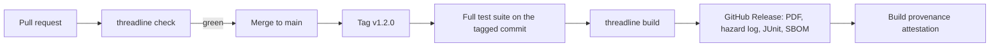

# CI and releases

## The GitHub Action

The repository root is a composite action that installs Threadline and runs `threadline check`.

```yaml
- uses: actions/checkout@v4
  with:
    fetch-depth: 0   # TL-D02 diffs against the base branch; TL-D03 reads signatures from history
- uses: actions/setup-python@v5
  with:
    python-version: "3.12"
- run: pip install pytest
- run: pytest --junitxml=junit.xml
- uses: JFrusher/threadline@main
  with:
    junit: junit.xml
    base: ${{ github.event_name == 'pull_request' && format('origin/{0}', github.base_ref) || '' }}
```

| Input | Default | Meaning |
|---|---|---|
| `path` | `.` | Directory holding `threadline.yaml` |
| `junit` | empty | JUnit XML with verification evidence. Empty skips the evidence rules |
| `base` | empty | Git ref to diff documents against. Empty skips TL-D02 |

A shallow clone has no history for TL-D03 to read, so `fetch-depth: 0` is required.

## Workflows from `threadline init`

| File | Runs on | Does |
|---|---|---|
| `threadline.yml` | Pull requests and pushes to `main` | Tests, then `threadline check` with evidence and the base ref |
| `sbom.yml` | Pull requests and weekly | Generates a CycloneDX SBOM with Syft, then `threadline check --sbom --osv` |
| `release.yml` | Tags matching `v*` | Builds and publishes the technical file |

The weekly SBOM run exists because new advisories appear without any change to your code.

## What counts as verification evidence



A pull request run gates the merge. It is not kept as a record.

The record is produced by `release.yml` on the tag. It re-runs the whole test suite on the tagged commit,
generates the SBOM, and runs `threadline build`, which fails if any rule fails. The PDF, `hazard-log.md`,
`junit.xml` and `sbom.cdx.json` are attached to the GitHub Release, and
`actions/attest-build-provenance` signs an attestation over them. The technical file prints the SHA-256 of
the JUnit file it was built from and carries the version and commit in every page footer.

## Before the first approval

Set up branch protection, CODEOWNERS and SSH commit signing as described in
[Branch protection and signing an approval](guides/branch-protection.md). Use merge commits or fast-forward
merges only: a squash merge discards the signed commit and TL-D03 rejects the approval.

## Pinning

Threadline is a tool in your QMS, so a new version is a change to validate (ISO 13485 §4.1.6). Pin the
action and the package to a tag or commit in your workflows and record the version in your tool validation
record (SOP-10 in the template).
