# CI and releases

## The GitHub Action

The repository root is a composite action that installs Threadline and runs `threadline check`.

```yaml
- uses: actions/checkout@v4
  with:
    fetch-depth: 0   # TL-D02 diffs against the base branch; TL-D03 reads signatures from history
- uses: actions/setup-python@v5
  with:
    python-version: "3.12"
- run: pip install pytest
- run: pytest --junitxml=junit.xml
- uses: JFrusher/threadline@main
  with:
    junit: junit.xml
    base: ${{ github.event_name == 'pull_request' && format('origin/{0}', github.base_ref) || '' }}
    trust-root: ${{ vars.THREADLINE_TRUST_ROOT }}
```

| Input | Default | Meaning |
|---|---|---|
| `path` | `.` | Directory holding `threadline.yaml` |
| `junit` | empty | JUnit XML with verification evidence. Empty skips the evidence rules |
| `base` | empty | Git ref to diff documents against. Empty skips TL-D02 |
| `trust-root` | empty | Commit whose signer registry is trusted (TL-D04). Pass an admin-set variable, never a value from the pull request |

The action runs `threadline check --format github`, so findings appear as annotations on the changed files.
A shallow clone has no history for TL-D03 and TL-D04 to read, so `fetch-depth: 0` is required.

## Setting the trust root

Set the repository variable `THREADLINE_TRUST_ROOT` (Settings, Secrets and variables, Actions, Variables) to
the commit that first added `qms/signers/allowed_signers`. Only admins can change repository variables, so a
pull request cannot move the root of trust. The scaffolded workflows already read it. If the only QA key is
lost, an admin commits a new registry and points the variable at that commit; see
[branch protection](guides/branch-protection.md#trust-root).

## Workflows from `threadline init`

| File | Runs on | Does |
|---|---|---|
| `threadline.yml` | Pull requests and pushes to `main` | Tests, then `threadline check` with evidence, the base ref and the trust root |
| `sbom.yml` | Pull requests and weekly | Generates a CycloneDX SBOM with Syft, then `threadline check --sbom --osv` |
| `release.yml` | Tags matching `v*` | Builds the technical file in a read-only job, then publishes it from a separate job |

All three pin Threadline to the version that ran `init`, and pin each third-party action to a commit.

The weekly SBOM run exists because new advisories appear without any change to your code.

## What counts as verification evidence

```mermaid
flowchart LR
  PR[Pull request] --> CHECK[threadline check]
  CHECK -->|green| MERGE[Merge to main]
  MERGE --> BL[threadline baseline v1.2.0]
  BL --> SIGN[approve BL-v1.2.0 as released]
  SIGN --> TAG[Tag v1.2.0]
  TAG --> RERUN[Full test suite on the tagged commit]
  RERUN --> BUILD[threadline build --release]
  BUILD --> REL[GitHub Release: PDF, hazard log, JUnit, SBOM]
  REL --> ATT[Build provenance attestation]
```



A pull request run gates the merge. It is not kept as a record.

To release:

```bash
threadline baseline v1.2.0
```

```bash
git add records/baselines && git commit -m "baseline v1.2.0"
```

```bash
threadline approve BL-v1.2.0 --meaning released --signer <you>
```

```bash
git tag v1.2.0 && git push origin v1.2.0
```

`release.yml` then re-runs the whole test suite on the tagged commit, generates the SBOM, and runs
`threadline build --release` with the trust root. The build refuses if any rule fails, if any rule other
than TL-D02 was skipped, or if the design file has changed since the baseline was approved. A second job,
the only one with write access, attaches the PDF, `hazard-log.md`, `junit.xml` and `sbom.cdx.json` to the
GitHub Release and signs a build-provenance attestation over them. The technical file prints the SHA-256 of
the JUnit file it was built from and carries the version and commit in every page footer.

## Before the first approval

Set up branch protection, CODEOWNERS, SSH commit signing and the trust root as described in
[Branch protection and signing an approval](guides/branch-protection.md). Use merge commits or fast-forward
merges only: a squash merge discards the signed commit and TL-D03 rejects the approval.

## Pinning

Threadline is a tool in your QMS, so a new version is a change to validate (ISO 13485 §4.1.6). Pin the
action and the package to a tag or commit in your workflows and record the version in your tool validation
record (SOP-10 in the template).
