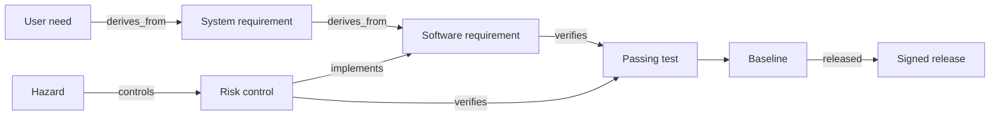
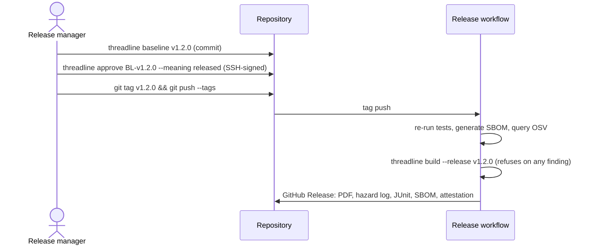

# Concepts

Threadline is built on a handful of ideas. Once you have them, every rule and command follows.

## The digital thread

Regulators want to see that each thing the device must do traces back to why it must do it, and forward to proof
that it does it. ISO 13485 calls it design control, IEC 62304 calls it traceability, ISO 14971 asks the same of every
risk control. Threadline calls the whole chain the thread:



The arrows show the direction of trust, not the direction in the files. In the files, links are stored on the child
and point up (`derives_from: [UN-001]`). That keeps every change local: adding a requirement never means editing its
parent.

## Items

Everything is an **item**: one file, whose name is its ID.

```yaml
# dhf/srs/SRS-002.yaml
id: SRS-002
type: software_requirement
title: Fast breathing threshold 2–11 months
text: Fast breathing shall be respiratory_rate >= 50 for 2 <= age_months < 12.
derives_from: [SYS-003]
implements: [RC-001]
```

Every item has `id`, `type`, `title`, `rev` (default 1) and `status`: `draft`, `in_review`, `effective` or
`obsolete`. The other fields depend on the type; there are 29 types, from `user_need` to `pccp`
([item reference](reference/items.md)).

Why one file per item ([ADR-001](adr/ADR-001-one-yaml-per-item.md)):

- `git log dhf/srs/SRS-002.yaml` is the item's complete, signed change history.
- Two people editing different requirements never conflict.
- If two pull requests create the same ID, git reports an add/add conflict. Threadline never allocates IDs.
- There is no index to keep in sync: the graph is rebuilt from the files on every run.

Documents (SOPs, plans, reports) are the one exception to "YAML only": they are Markdown files with YAML frontmatter,
so they read well on GitHub and in the PDF.

## Evidence

A test verifies an item when its JUnit XML testcase carries `<property name="verifies" value="SRS-002"/>`
([ADR-002](adr/ADR-002-junit-property-test-link.md)). The pytest plugin writes it for you:

```python
@pytest.mark.verifies("SRS-002", "RC-001")
def test_infant_threshold(): ...
```

Other frameworks emit the same property (GoogleTest: `RecordProperty("verifies", "SRS-002")`). One mechanism, any
language.

An item counts as verified only when it has at least one test **and every test that claims it passes**. A skipped
test is not a pass. One green test can't hide a red one.

Pull request runs gate merges; they are not records. The record is the full suite re-run on the tagged commit by the
release workflow, embedded in the technical file and attached to the GitHub Release.

## Rules

A rule is a function over the graph that yields findings. Each has an ID, the clause it enforces, and optionally an
input it needs:

| Input | Comes from | Rules that need it |
|---|---|---|
| evidence | `--junit junit.xml` | TL-E01, TL-E02, TL-R04 |
| sbom | `--sbom sbom.cdx.json` (CycloneDX, e.g. from Syft) | TL-P01, TL-P02 |
| advisories | `--osv` (queries OSV.dev for the SBOM's packages) | TL-P03 |
| base_ref | `--base origin/main` | TL-D02 |
| git_root | running inside a git work tree | TL-D03, TL-D04 |
| release | `--release v1.2.0` | TL-D05 |

Without its input a rule is **skipped** and reported as such. `build --release` refuses to run with anything
skipped (except TL-D02, which needs a base branch a tag build doesn't have).

Every rule has a passing and a failing fixture in `tests/fixtures/`. That suite is Threadline's
[tool-validation evidence](tool-validation/threadline-intended-use-and-risk.md).

## Profiles

Two kinds of profile turn standards into checks:

- **Lifecycle profile** (`iec62304-ed1` or `iec62304-ed2-draft`): which activities and deliverables each software
  class needs. TL-C01 checks they exist. The Ed2 profile follows an unpublished draft and prints a `DRAFT STANDARD`
  banner on every run.
- **Regulatory profiles** (`uk-mhra`, `au-model-law`, plus ISO 13485 always): a checklist of clauses and the
  classification schemes each market needs. TL-G01 and TL-G02 check them.

## Documents and signatures

A document moves `draft → in_review → effective → obsolete`. To become effective it needs approvals.

An **approval** is itself an item, in `records/approvals/`:

```yaml
id: APR-SOP-10-r2-authored-ann
type: approval
subject: SOP-10
subject_rev: 2
subject_sha256: 6406c90e…   # hash of id, doc_type, title, rev and body
meaning: authored           # authored | reviewed | approved_as_qa | released
signer: ann
signed_at: '2026-11-16T12:34:37Z'
```

What makes it a signature ([ADR-003](adr/ADR-003-signed-approval-records.md)):

1. **It's signed.** The commit that adds the record carries a valid SSH signature from the signer's key
   (TL-D03).
2. **The key was registered first.** The signature is checked against `qms/signers/allowed_signers` as it was
   *before* that commit, so nobody can add a key and use it in the same breath.
3. **It's bound to content.** `subject_sha256` covers the document's identity and body. Change one character and the
   approval stops counting (TL-D01).
4. **It's the right person.** The signer holds the role the meaning needs, and a review or QA approval can't be
   signed by the author.
5. **It's immutable.** A record changed after its signing commit fails TL-D03.

The signer registry is guarded too: every change after its first commit must be signed by a QA signer the registry
already trusted (TL-D04).

## Trust root

Something has to be trusted first. By default it's the commit that created the signer registry. That's fine on day
one, but anyone with push access could, in principle, rewrite history to plant a different "first" registry.

So in CI the anchor lives outside the repository: a repository variable `THREADLINE_TRUST_ROOT`, settable only by
admins, names the trusted commit. Threadline verifies every registry change after it. If the only QA key is lost, an
admin re-roots by committing a new registry and pointing the variable at it: an audited act a pull request author
can't perform. Release builds refuse to run without a trust root.

## Baselines and releases

A **baseline** freezes the design file for a release. It holds one SHA-256 over every item file except approvals and
baselines. A `released` approval of the baseline, signed by a release manager, is the release decision. On the
release tag, TL-D05 checks that the baseline exists, is approved, and still matches the design file byte for byte.



## The technical file

`threadline build` assembles the design file into Markdown, renders Mermaid diagrams, and typesets a PDF with Pandoc
and XeLaTeX. Every page footer carries the product, version and commit. Item IDs are hyperlinks. Signature
manifestations (who, when, meaning) are printed. Fictional or illustrative data is flagged on the cover and next to each summative report, and a draft lifecycle profile gets a `DRAFT STANDARD` banner. A DCB0129 hazard log
is written alongside.

Item text is treated as untrusted: raw LaTeX and HTML are disabled in Pandoc, and images must be files inside the
project.
