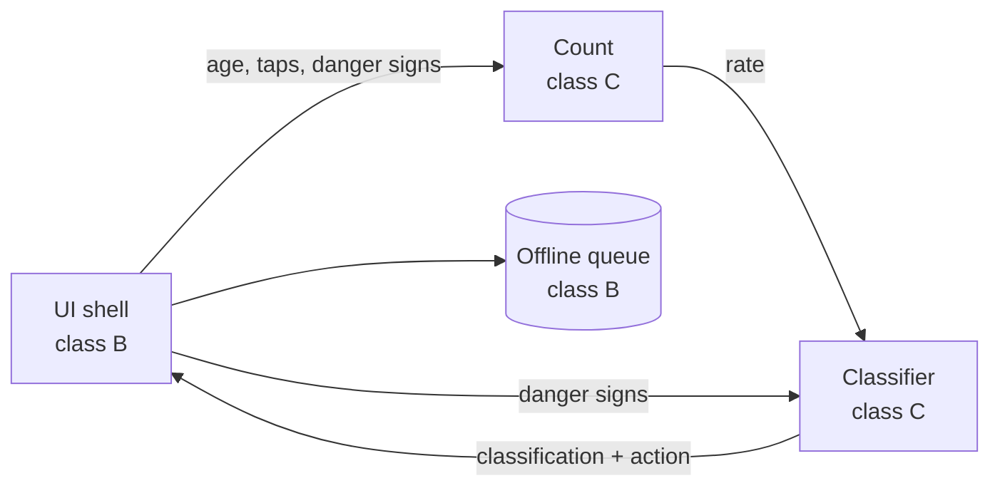

# Software Architecture — Breathe-Triage

The classifier and counter (class C) are pure functions with no I/O and no SOUP. The UI shell and offline queue
(class B) cannot change a classification: they only display and store it. Segregation is by module boundary and by
the rule that class C code imports nothing outside the standard library (SRS-011 test).
